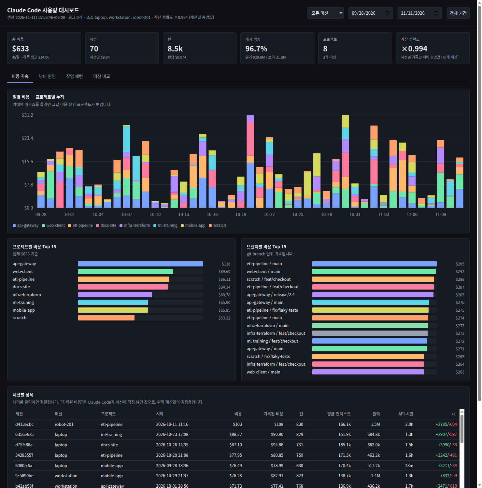
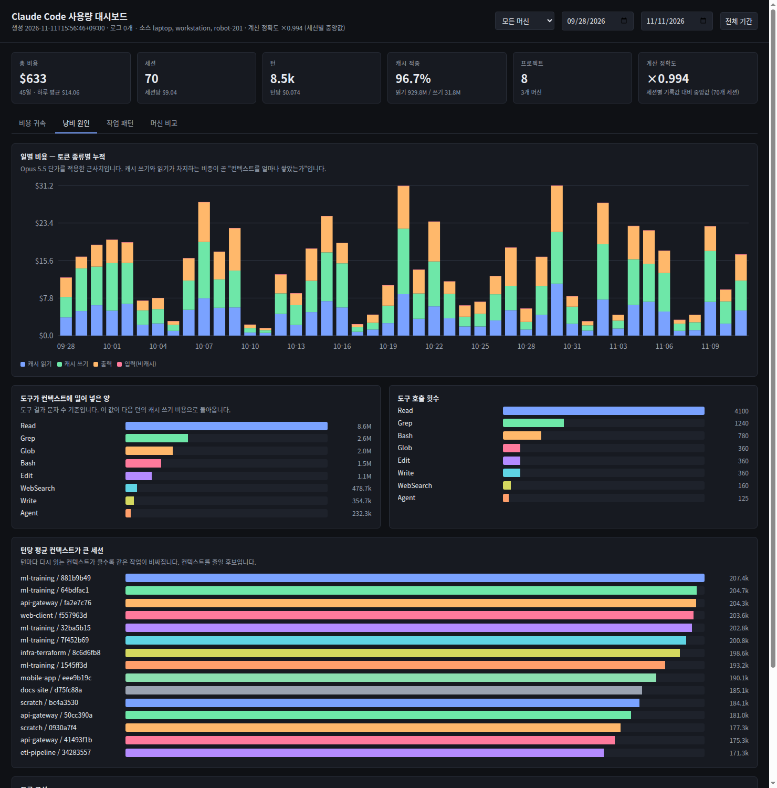
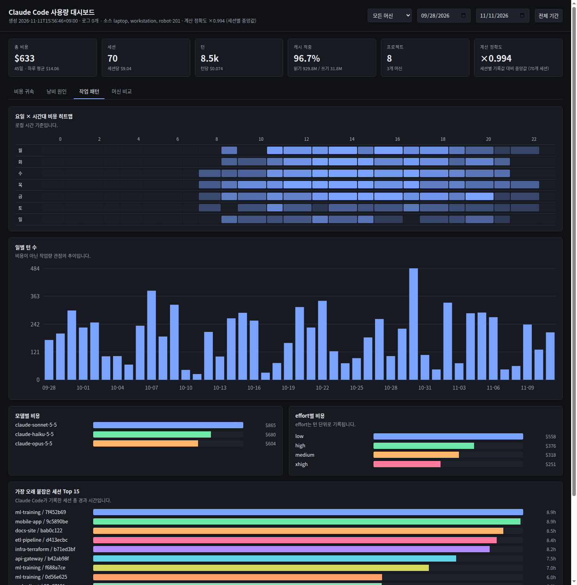
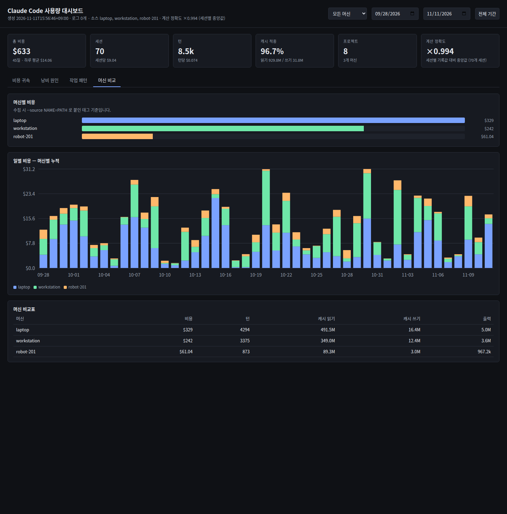

<div align="center">

# TokenWatch

**Claude Code 사용량이 어디로 갔는지 봅니다 — 프로젝트별, 세션별, 머신별로.**

Claude Code는 세션마다 비용을 이미 기록해 둡니다. 다만 그 내역을 보여주지는 않습니다.
TokenWatch는 그 기록을 읽어서 하나의 HTML 대시보드로 만듭니다.

[English README](README.md)

[](LICENSE)
[](https://www.python.org/)
[](#요구-사항)



<sub>프로젝트별 일별 비용 · 브랜치 단위 귀속 · 모든 세션을 정렬해서 확인 — 전부 오프라인, 파일 하나로.</sub>

</div>

---

## 왜 필요한가

`~/.claude/projects/**/*.jsonl` 에는 지금까지 실행한 모든 턴이 남아 있습니다. 모델,
effort, 토큰 수, 호출한 도구, 그 도구가 돌려준 양까지 전부 들어 있습니다. *"지난주에 왜
그만큼 썼지?"* 에 답할 재료는 이미 디스크에 있는데, 그것을 읽는 도구가 없습니다.

그래서 짐작에 의존하게 됩니다. 화요일의 리팩터링 때문이었을까요, 아니면 40만 토큰짜리
컨텍스트를 아홉 시간 동안 끌고 간 세션 하나 때문이었을까요? 예상한 저장소였을까요,
아니면 잊고 있던 임시 디렉터리였을까요? 서브에이전트가 도움이 됐을까요, 아니면 조용히
비용을 두 배로 올렸을까요?

TokenWatch는 이 네 가지 질문에 탭 하나씩으로 답합니다.

## 무엇을 보여주는가

**비용 귀속** — 프로젝트별로 쌓은 일별 비용, 프로젝트·git branch 단위 랭킹, 그리고 턴 수와
평균 컨텍스트, API 시간, 변경 줄 수까지 담은 세션 표를 제공합니다.

**낭비 원인** — 같은 일별 비용을 프로젝트가 아니라 *토큰 종류*로 나눕니다. 캐시 읽기, 캐시
쓰기, 출력, 비캐시 입력은 단가가 각각 다르기 때문에, 이 그래프가 돈이 실제로 무엇에 쓰였는지
보여줍니다. 그 아래에는 도구별로 컨텍스트에 밀어 넣은 문자 수와, 턴마다 가장 큰 컨텍스트를
다시 읽은 세션이 나옵니다.



**작업 패턴** — 요일 × 시간대 히트맵, 일별 턴 수, 모델별·effort별 비용, 그리고 경과 시간이
가장 길었던 세션을 보여줍니다.



**머신 비교** — 여러 호스트에서 모은 로그를 지정하면 같은 지표를 머신별로 비교합니다.

## 설치

virtualenv도 `pip install` 도 필요 없습니다. Python 스크립트 하나와 HTML 템플릿뿐입니다.

```bash
git clone https://github.com/wntdev99/tokenwatch.git
cd tokenwatch
python3 tokenwatch.py --open
```

`~/.claude/projects` 를 읽어서 `tokenwatch-report.html` 을 만들고 브라우저로 엽니다.

<details>
<summary>로그 없이 먼저 보기</summary>

```bash
python3 tokenwatch.py --demo --open
```

합성 데이터로 같은 대시보드를 그립니다. 위 스크린샷이 이 화면입니다.

</details>

## 사용법

```
python3 tokenwatch.py [-o OUT.html] [--since YYYY-MM-DD] [--until YYYY-MM-DD]
                      [--source NAME=PATH ...] [--json AGG.json] [--demo] [--open]
```

| 옵션 | 동작 |
| --- | --- |
| `--source NAME=PATH` | 머신 이름을 붙인 로그 경로입니다. 여러 번 쓸 수 있습니다. 기본값은 `local=~/.claude/projects` |
| `--since` / `--until` | 읽을 기간을 제한합니다. 대시보드 안에도 날짜 필터가 있습니다 |
| `-o`, `--out` | 리포트를 쓸 위치입니다. 기본값은 `tokenwatch-report.html` |
| `--json` | 집계 결과를 JSON으로도 내보냅니다 |
| `--demo` | 합성 데이터를 사용합니다 |
| `--open` | 완료 후 브라우저로 엽니다 |

리포트는 데이터를 안에 품은 단일 파일입니다. 서버도 네트워크도 필요 없으므로 메일로 보내거나
저장소에 커밋해도 그대로 열립니다.

### 머신이 여러 대일 때

Claude Code는 로그에 호스트 식별자를 남기지 않기 때문에, 머신 이름은 직접 붙여야 합니다.
다른 호스트의 기록을 내려받은 뒤 이름을 지정하면 됩니다.

```bash
rsync -a --include='*/' --include='*.jsonl' --exclude='*' \
      robot-201:'~/.claude/projects/' /tmp/logs/robot-201/

python3 tokenwatch.py \
  --source laptop=~/.claude/projects \
  --source robot-201=/tmp/logs/robot-201 \
  --open
```

그러면 헤더의 머신 필터가 모든 탭에 적용되고, 네 번째 탭에서 나란히 비교됩니다.



## 숫자를 만드는 방식

1. 모든 `assistant` 레코드에는 `usage` 블록이 있습니다. `input_tokens`, `output_tokens`,
   `cache_read_input_tokens`, 그리고 5분·1시간으로 나뉜 `cache_creation` 이 들어 있습니다.
   각각에 해당 단가를 적용해 턴 단위로 합산합니다.
2. **하나의 API 응답은 트랜스크립트에 여러 번 기록됩니다.** content block마다 한 번씩
   기록되는데, 각 사본이 동일한 `usage` 를 그대로 들고 있습니다. 레코드를 그대로 세면 전체
   턴의 절반가량이 중복 계상됩니다. TokenWatch는 `message.id` 로 중복을 제거한 뒤에
   단가를 적용합니다.
3. 서브에이전트 기록은 `<세션>/subagents/**.jsonl` 에 따로 쌓이며 실제로 비용을 발생시킵니다.
   이 기록도 읽어서 그것을 생성한 세션에 귀속시킵니다.
4. Claude Code는 자체 누적 비용을 담은 `cost-state` 레코드도 남깁니다. TokenWatch는 세션별로
   자신의 계산을 이 값과 대조하고 결과를 출력합니다.

   ```
   accuracy: median per-session ratio 0.954 over 56 sessions
   ```

   이 중앙값이 정확도를 나타내는 값이며, 대시보드 헤더에도 표시됩니다. 합계끼리의 차이를
   오차로 읽으면 안 되는데, 그 이유는 아래에 있습니다.

## 알려진 한계

- **여기 나오는 금액은 API 환산 비용이지 청구서가 아닙니다.** 공개된 토큰 단가로 계산한
  값입니다. Claude Code 구독을 쓰고 있다면 이 숫자는 "같은 작업을 API로 했다면 들었을
  비용"입니다. 프로젝트끼리 비교하는 용도로는 맞지만, 카드 명세서와 맞춰볼 값은 아닙니다.
- **`cost-state` 는 최종값이 아니라 중간 스냅샷입니다.** 세션이 돌아가는 중에 기록되기
  때문에, 갑자기 끝난 세션은 실제보다 훨씬 적게 남습니다. 실제로 턴 기준 $244를 쓴 세션이
  $0.72로 기록된 사례가 있습니다. 합계가 아니라 세션별 중앙값을 정확도 지표로 쓰는 이유입니다.
- **단가는 소스 안의 표입니다.** `tokenwatch.py` 상단의 `PRICING` 에 작성 시점의 단가가
  들어 있습니다. 모델이 추가되거나 단가가 바뀌면 한 줄만 고치면 됩니다. 표에 없는 모델은
  Opus 단가로 처리하므로, 저렴한 모델에 대해서는 과대 추정이 됩니다.
- **프로젝트 이름은 작업 디렉터리 기준입니다.** 같은 저장소를 두 군데에 체크아웃하면 두 개의
  프로젝트로 세고, 하위 디렉터리에서 `cd` 후 실행하면 또 하나가 생깁니다.
- **타임스탬프가 없는 턴은 건너뜁니다.** 기록 도중 잘린 레코드도 마찬가지입니다.

## 요구 사항

| | |
| --- | --- |
| Python | 3.9 이상, 표준 라이브러리만 사용 |
| 입력 | Claude Code가 쓰는 `~/.claude/projects` |
| 브라우저 | 최신 브라우저면 충분합니다. 리포트는 순수 HTML·CSS·SVG입니다 |

## 라이선스

[MIT](LICENSE)
