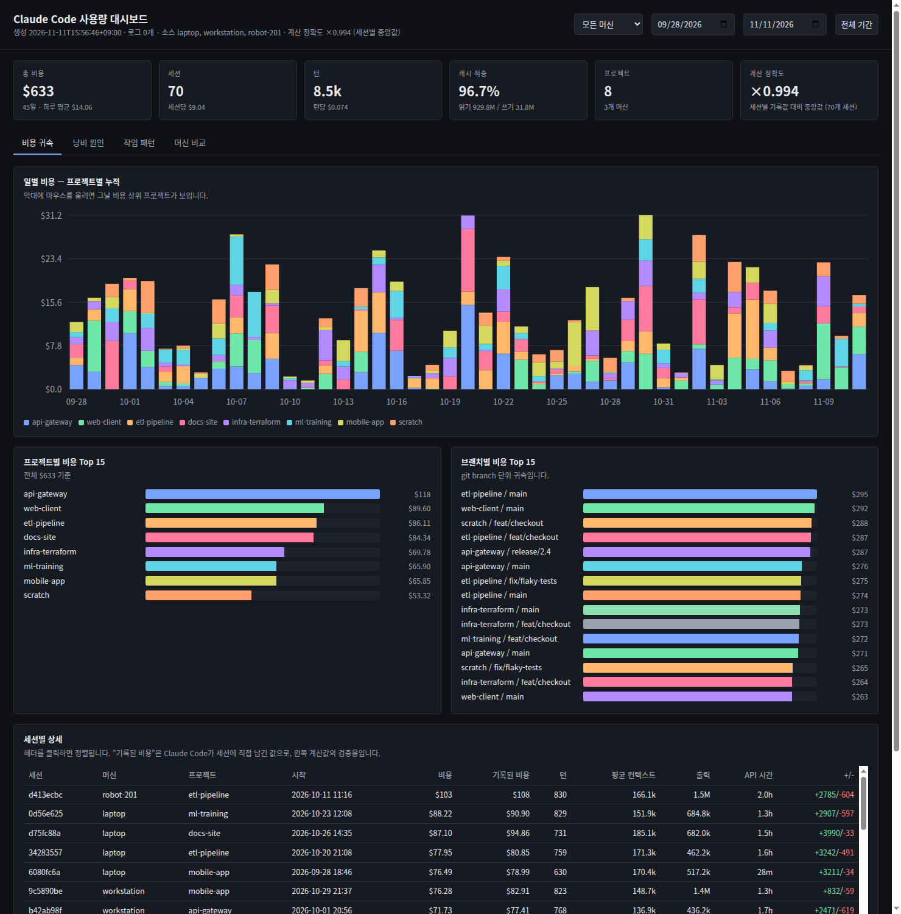
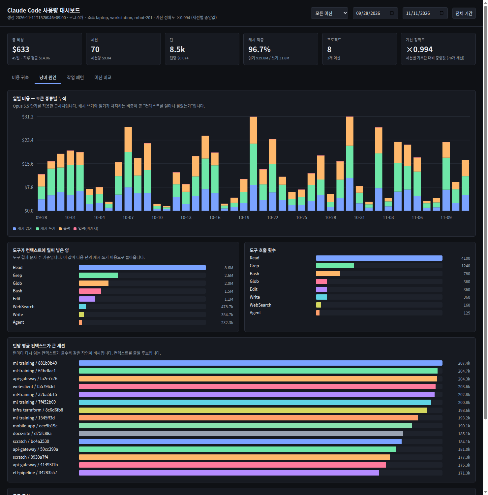
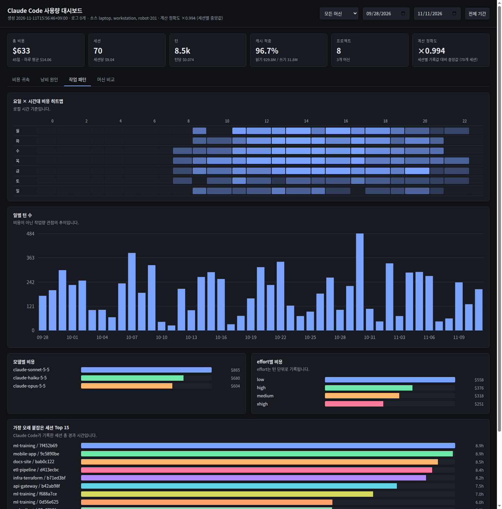
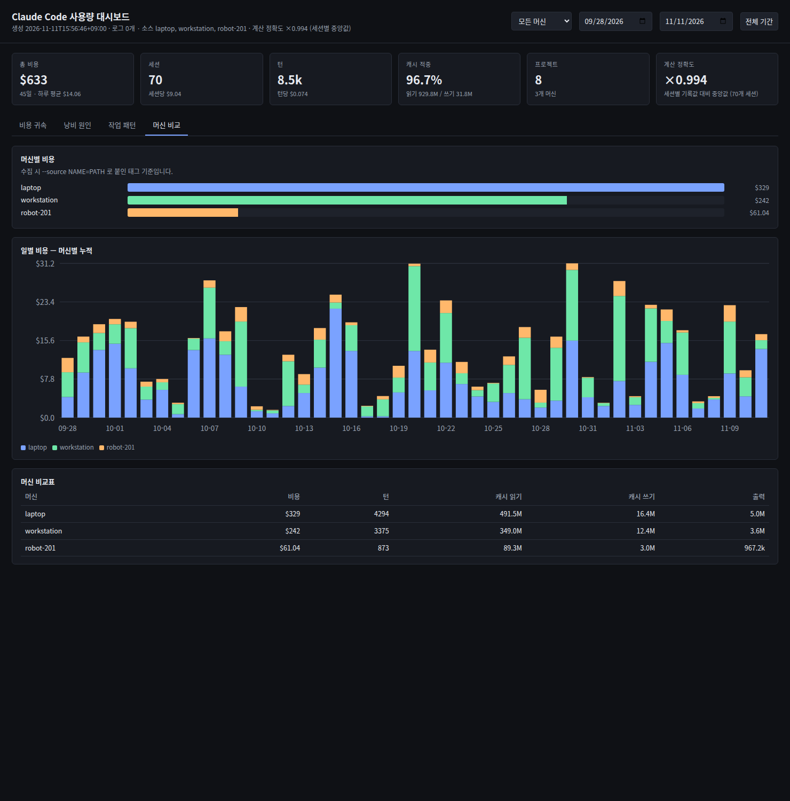

<div align="center">

# TokenWatch

**See where your Claude Code tokens actually go — across every project, session and machine.**

Claude Code already writes down what each session cost. It just never shows you the bill.
TokenWatch reads those transcripts and turns them into one self-contained HTML dashboard.

[한국어 README](README.ko.md)

[](LICENSE)
[](https://www.python.org/)
[](#requirements)
[](#usage)



<sub>Daily cost by project · per-branch attribution · every session, sortable — all offline, in one file.</sub>

</div>

---

## Why

`~/.claude/projects/**/*.jsonl` holds every turn Claude Code has ever run on your machine:
the model, the effort level, the token counts, the tools it called and how much they
returned. The information needed to answer *"why did last week cost that much?"* is already
on disk. Nothing reads it.

So you end up guessing. Was it the refactor on Tuesday, or the one session that kept a
400k-token context alive for nine hours? Was it the repo you expected, or the scratch
directory you forgot about? Did the subagents help, or did they quietly double the bill?

TokenWatch answers those four questions, one per tab.

## What it shows

**Cost attribution** — daily cost stacked by project, ranked by project and by git branch, and
a sortable table of every session with its turns, average context, API time and lines changed.

**Waste tracing** — the same daily cost split by *token kind* instead of project. Cache reads,
cache writes, output and uncached input are priced separately, so the chart shows what your
money is actually buying. Underneath it: how many characters each tool pushed into the
context, and which sessions re-read the largest context on every turn.



**Work patterns** — a weekday × hour heatmap, daily turn counts, cost by model and by effort
level, and the sessions that ran longest in wall-clock time.



**Machine comparison** — the same numbers per machine, once you point TokenWatch at logs
collected from more than one host.

## Install

No virtualenv, no `pip install` — it is a Python script and an HTML template:

```bash
git clone https://github.com/wntdev99/tokenwatch.git
cd tokenwatch
python3 tokenwatch.py --open
```

That reads `~/.claude/projects`, writes `tokenwatch-report.html` next to you and opens it.

<details>
<summary>Try it without any logs</summary>

```bash
python3 tokenwatch.py --demo --open
```

Renders synthetic data — the same dashboard, made-up projects. This is what the screenshots
above show.

</details>

## Usage

```
python3 tokenwatch.py [-o OUT.html] [--since YYYY-MM-DD] [--until YYYY-MM-DD]
                      [--source NAME=PATH ...] [--json AGG.json] [--demo] [--open]
```

| Flag | Effect |
| --- | --- |
| `--source NAME=PATH` | A log root tagged with a machine name. Repeatable. Default: `local=~/.claude/projects` |
| `--since` / `--until` | Limit the turns that are read (the dashboard also has date filters) |
| `-o`, `--out` | Where to write the report. Default `tokenwatch-report.html` |
| `--json` | Also dump the aggregated numbers, if you want to chart them elsewhere |
| `--demo` | Synthetic data, for screenshots and for a look before you commit |
| `--open` | Open the report in your browser when it is done |

The report is a single file with the data inlined. It needs no server and no network — mail
it, commit it, open it on a plane.

### More than one machine

Claude Code writes no host identifier into its logs, so the machine tag comes from you.
Pull the other host's transcripts down and name them on the command line:

```bash
rsync -a --include='*/' --include='*.jsonl' --exclude='*' \
      robot-201:'~/.claude/projects/' /tmp/logs/robot-201/

python3 tokenwatch.py \
  --source laptop=~/.claude/projects \
  --source robot-201=/tmp/logs/robot-201 \
  --open
```

The machine filter in the header then applies to every tab, and the fourth tab compares them
side by side.



## How the numbers are produced

1. Every `assistant` record carries a `usage` block: `input_tokens`, `output_tokens`,
   `cache_read_input_tokens`, and `cache_creation` split into 5-minute and 1-hour entries.
   Each is priced at its own published rate and summed per turn.
2. **One API response is written to the transcript several times** — once per content block,
   each copy carrying an identical `usage`. Billing every record double-counts roughly half of
   all turns. TokenWatch deduplicates on `message.id` before pricing anything.
3. Subagent transcripts live in `<session>/subagents/**.jsonl` and cost real money. They are
   read too, and billed to the session that spawned them.
4. Claude Code also writes a `cost-state` record holding its own running total.
   TokenWatch compares its arithmetic against that record per session and prints the result:

   ```
   accuracy: median per-session ratio 0.954 over 56 sessions
   ```

   That median is the honest accuracy number, and it is shown in the dashboard header. Do not
   read the aggregate difference as error — see below.

## Known limitations

- **These are API-equivalent prices, not your invoice.** Costs are computed from the published
  per-token rates. On a Claude Code subscription the number tells you what the work *would*
  cost through the API, which is the right figure for comparing projects against each other,
  and the wrong one to expect on a credit card statement.
- **`cost-state` is a snapshot, not a final total.** It is written while the session runs, so
  a session that ended abruptly reports far less than it spent — one session here records
  $0.72 against $244 of real turns. That is why the per-session median, not the sum, is used
  as the accuracy measure.
- **Prices are a table in the source.** `PRICING` at the top of `tokenwatch.py` carries the
  rates this was written against. A new model, or a price change, is a one-line edit; an
  unknown model falls back to the Opus rate and is therefore an over-estimate for cheap models.
- **Projects are named after the working directory.** Two checkouts of the same repo in
  different directories count as two projects, and `cd` into a subdirectory starts a third.
- **Turns with no timestamp are skipped**, as are records the transcript truncated mid-write.
- **The interface is in Korean.** The tool was written for a Korean-speaking team.
  Translation is welcome.

## Requirements

| | |
| --- | --- |
| Python | 3.9 or newer, standard library only |
| Input | `~/.claude/projects` as Claude Code writes it |
| Browser | Anything current; the report is plain HTML, CSS and SVG |

## License

[MIT](LICENSE)
